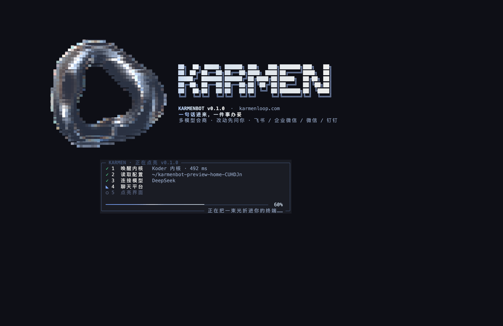

# karmenbot

karmenbot is KARMEN's full-screen terminal assistant. Open it in a folder, connect a model, and describe the work. It shows file changes and commands for approval before carrying them out.

[Quick start](#quick-start) · [Platforms](#platforms) · [Docs](#docs) · [Contributing](#contributing) · [License](#license) · [Contact](#contact)

The source here is [GPL-3.0-only](LICENSE), with the linking exception described below. The Koder kernel is proprietary, comes from the official site, and is not included in this repository. See [License](#license).



## What it is

Use it for work in the folder you opened: reading code, reviewing a diff, making edits, or running commands. You can ask several configured models for input before one of them carries out the task. Chat app connections are optional and use a background process on your computer.

The [setup guide](docs/GUIDE.md) walks through installation, model setup, and your first saved file.

This terminal app is separate from the KARMEN BOT mobile app, which is not available for download. Payments, orders, and commitments still require your decision.

## What it does

- **The screen.** A glass-ring open, then the session, the conversation, and a line to type on. Arrows or the mouse. `/settings` is the whole setup.
- **Read or write.** `karmenbot ask` only reads. `karmenbot run` can edit, and it still waits for `y`. `review` writes up the diff. `fix` reruns your check. `test` adds tests in the style already in the folder.
- **Memory, flows, CI.** `karmenbot memory` keeps notes for this folder. `karmenbot flow` runs a JSON list of steps. `karmenbot ci init` adds a pull-request review workflow.
- **Editors.** Zed, Neovim, and Emacs can talk to `karmenbot acp`. `karmenbot editor` prints the snippet.
- **The folder.** It can read on its own. A write shows the diff. A command shows the exact line. `y` accepts, `n` or `Esc` sends it back.
- **A model you bring.** Pick the provider, paste the key, test it. The key stays in `~/.karmenbot`, mode 600. Dots on screen, not the key.
- **A few models on one job.** They each take a look. One of them combines that and actually does the work. Off unless you turn it on.
- **Chat apps, if you want them.** Scan a code for Feishu, WeCom, DingTalk, and personal WeChat. A short form for Telegram, Slack, Discord, and WhatsApp Business. First contact from anyone else needs your approval on this computer.
- **A background process.** Start it when chat should keep working after you close the window. Start-at-login is a switch, not a separate installer.
- **The site, from inside the app.** [karmenloop.com](https://karmenloop.com), the updates page, and a version check. The check does not send your key or your files.

## Platforms

macOS 12 or later, Intel or Apple silicon. Windows 10 and 11, in Windows Terminal, PowerShell, or CMD. Linux with glibc 2.28 or later, including Ubuntu 20.04 and newer. No admin password on macOS or Linux.

Windows 7, Windows 8, and XP cannot install it. Node.js 22 does not run there.

## Quick start

### Install

macOS and Linux:

```bash
curl -fsSL https://karmenloop.com/downloads/karmenbot/install.sh | sh
```

Windows PowerShell:

```powershell
irm https://karmenloop.com/downloads/karmenbot/install.ps1 | iex
```

Windows CMD:

```bat
curl -fsSL https://karmenloop.com/downloads/karmenbot/install.cmd -o %TEMP%\karmenbot-install.cmd && %TEMP%\karmenbot-install.cmd
```

If Node.js 22 is not there, the installer brings a private copy.

When it finishes, Settings opens. Open a new terminal window so `PATH` is current, then:

```bash
karmenbot --version
karmenbot
```

In Settings, open **Models**, add a provider, paste the key, and choose **Save and test**. Green means you are done with setup. Type a job. When the diff shows up, press `y`.

For the full walkthrough, including chat app setup, see [docs/GUIDE.md](docs/GUIDE.md).

### From source

For people changing this repo. You still need the kernel from the official site. It is not in the clone.

```bash
git clone https://github.com/KarmenLoop/karmenbot.git
cd karmenbot
node scripts/fetch-kernel.mjs --from https://karmenloop.com/downloads/karmenbot
npm test
node bin/karmenbot.mjs
```

Node.js 22 or newer. No npm packages to install.

`npm run test:source` checks the public protocol adapters and export boundaries without a kernel. The full `npm test` suite also needs a verified kernel in `vendor/`. A failed kernel download is an installation failure; passing the source checks does not make that installation usable.

## Docs

| | |
|---|---|
| [Setup guide](docs/GUIDE.md) | Install, the model, the first saved file, then each chat app |
| [The screen](docs/TUI.md) | What you are looking at, keys, screenshots |
| [macOS](docs/教程-macOS.md) · [Windows](docs/教程-Windows.md) · [Linux](docs/教程-Linux.md) | The same path, in Chinese, with that system’s keys |
| [Updates](https://karmenloop.com/updates.html) | What shipped |
| [Product](https://karmenloop.com/karmen-bot.html) | KARMEN BOT on the site |

Inside the app, `karmenbot learn` prints the Chinese chapters for the system you are on.

## Contributing

Issues and pull requests are welcome. A change to this repository is under GPL-3.0-only, plus the kernel exception in [LICENSE-EXCEPTION.md](LICENSE-EXCEPTION.md).

Please don’t paste API keys, bot tokens, or pairing codes into an issue. Mail [info@karmenloop.com](mailto:info@karmenloop.com) if it is a security report.

The kernel is not accepted as a pull request here. It is closed, and it ships from the site.

## License

Copyright © 2026 KARMEN. The files in this repository are under the GNU General Public License v3.0 only. The text is [LICENSE](LICENSE).

[LICENSE-EXCEPTION.md](LICENSE-EXCEPTION.md) lets you ship this code together with the closed Koder kernel. The kernel’s own terms are [KERNEL-LICENSE.md](KERNEL-LICENSE.md): fine to use with karmenbot, including commercially; not fine to ship on its own, modify, or reverse engineer. The kernel is not licensed under GPL, and it is not in this repository.

Other attributions are in [THIRD_PARTY_NOTICES.md](THIRD_PARTY_NOTICES.md). That file is the list. This readme does not add to it.

## Contact

[GitHub](https://github.com/KarmenLoop/karmenbot) · [info@karmenloop.com](mailto:info@karmenloop.com) · [karmenloop.com](https://karmenloop.com)
