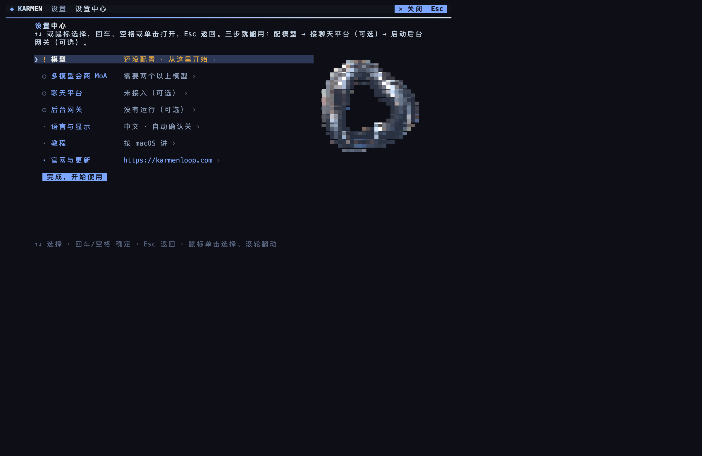
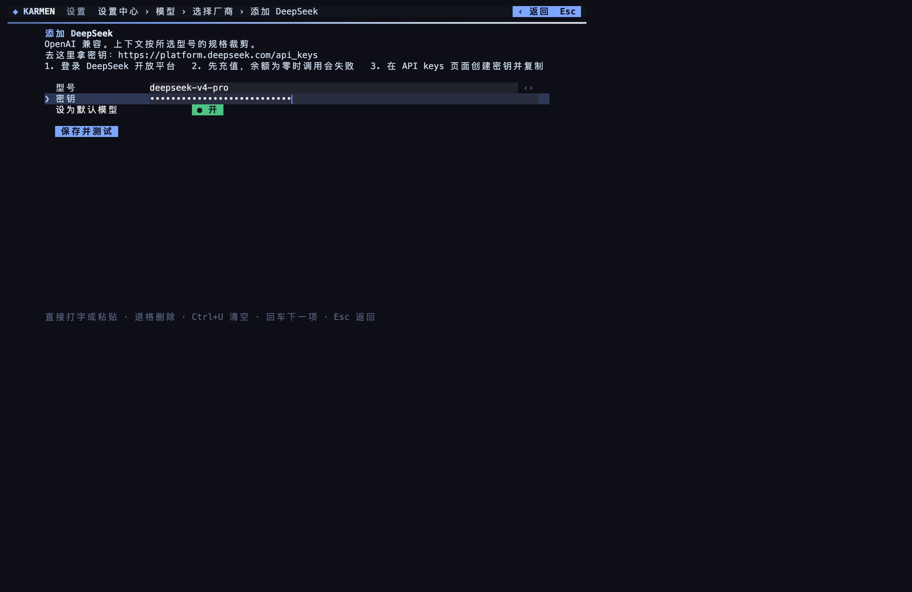
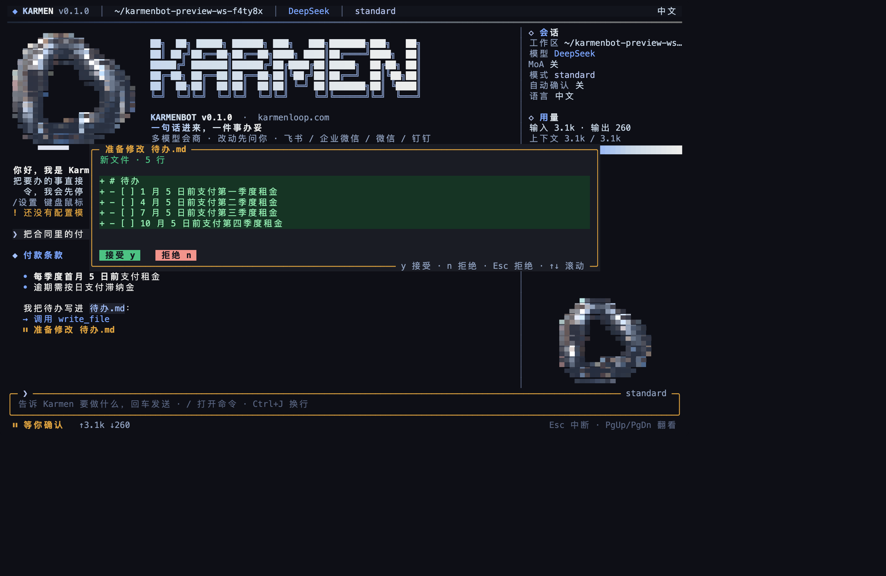
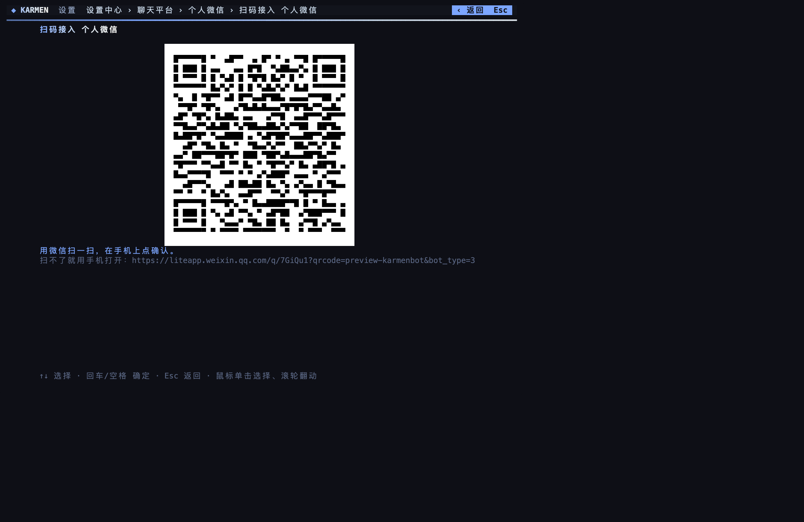

# KARMEN and karmenbot

KARMEN is the brand. The site is [karmenloop.com](https://karmenloop.com). The email is [info@karmenloop.com](mailto:info@karmenloop.com).

On the site, KARMEN / Koder is the product family. Koder is the desktop app: an editor, a terminal command, and a full-screen terminal. KARMEN BOT is described there as one product for one person. It acts only with your permission. Payment, a promise, and a submitted order wait for you. The site also says the phone app is not available for download yet.

karmenbot is the full-screen terminal in that family. It runs on your computer. You write the job. It reads files, writes documents, organizes material, and runs commands in the folder you opened. A write shows the diff first. A command shows the exact line first. `y` accepts. `n` or `Esc` rejects.

The Koder kernel that does this work is not public. It is not in this repository. The installer downloads it from the official site into `vendor/`.

This guide takes you from an empty terminal to a working session. Chat apps are optional and come after the session already works.


## What “working” means

Stop when all of these are true:

1. `karmenbot --version` prints a version.
2. Settings shows a model with a green connection test.
3. You have sent one job, seen a diff or a command, pressed `y`, and seen the result on disk.
4. Only if you want a chat app: that app is connected, the background gateway is running, and a message from your own account gets a reply.

You do not need a chat app for the terminal to be usable.

## 1. Check the computer

| System | Can install |
|---|---|
| macOS 12 or later, Intel or Apple silicon | Yes. No administrator password. |
| Windows 10 or Windows 11 | Yes. Use Windows Terminal, PowerShell, or CMD. |
| Windows 7, Windows 8, XP | No. Node.js 22 does not run there. |
| Ubuntu 20.04+, Debian 10+, Fedora, Arch, openSUSE, 64-bit or ARMv7 | Yes. No `sudo`. |
| Ubuntu 18.04 and other systems with glibc older than 2.28 | No. The installer says so and stops. |
| Alpine and other musl systems | Install Node.js 22 with the system package manager first, then run the installer. |

## 2. Install

Open a terminal:

- macOS: `⌘ Space`, type Terminal, press Enter.
- Windows 11: right-click Start, choose Terminal.
- Windows 10: right-click Start, choose Windows PowerShell.
- Ubuntu: `Ctrl+Alt+T`.

Paste one line and press Enter.

macOS or Linux, paste with `⌘V` on macOS and `Ctrl+Shift+V` on Linux:

```bash
curl -fsSL https://github.com/KarmenLoop/karmenbot/releases/latest/download/install.sh | sh
```

Windows PowerShell, paste with `Ctrl+V` or right-click:

```powershell
irm https://github.com/KarmenLoop/karmenbot/releases/latest/download/install.ps1 | iex
```

Windows CMD:

```bat
curl -fsSL https://github.com/KarmenLoop/karmenbot/releases/latest/download/install.cmd -o %TEMP%\karmenbot-install.cmd && %TEMP%\karmenbot-install.cmd
```

Pages: [Download](https://karmenloop.com/download.html) · [Updates](https://karmenloop.com/updates.html) · [Product](https://karmenloop.com/karmen-bot.html)

Watch the list. Each line turns into a check:

1. System check.
2. Node.js 22, the one already installed or a private copy the installer downloads.
3. Release information for this version.
4. Download. The archive and the kernel are checked with SHA-256. A mismatch stops the install and writes nothing.
5. Install.
6. PATH.

Settings open when this finishes. If the last line tells you to open a new terminal, do that before the next step. A new window is what picks up PATH.

Confirm:

```bash
karmenbot --version
```

You should see `karmenbot` and a version. `command not found` means the old window is still in use. Open a new one. If it is still missing:

```bash
export PATH="$HOME/.local/bin:$PATH"
```

On Windows, close CMD or PowerShell and open it again. The installer adds the user PATH entry `%USERPROFILE%\.karmenbot\bin`.

Slow Node download: before the install line, run `export KARMENBOT_NODE_MIRROR=https://npmmirror.com/mirrors/node`.

## 3. Settings, key by key

The first `karmenbot` with no model opens Settings. Later: type `/settings` and press Enter, or run `karmenbot settings`.



| You want | Keyboard | Mouse |
|---|---|---|
| Move | `↑` `↓` | Move to the row |
| Open, toggle, or confirm | Enter or Space | Left click |
| Back | `Esc` | The back control at the top |
| Scroll | `PgUp` `PgDn` | Wheel |
| Type in a field | Select the field and type. Paste with the terminal paste key above. | Click the field. A click focuses it. It does not skip to the next field. |

On Windows, mouse clicks work in Windows Terminal. In an old console window, use the keyboard. The keyboard can finish every step.

The home page lists, in order: Models, Mixture of Agents, Chat apps, Gateway, Language and display, Tutorial, Official site, then **Done, start using it**. Do not press Done yet.

## 4. Add a model

This step is required.

1. On the home page, Models says “not set · start here”. Press Enter.
2. Press Enter on **+ Add model**.
3. The vendor list is long. Type to filter. `deep` leaves DeepSeek near the top. Press Enter on the vendor you will pay.
4. The model id is already filled. Change it only if that vendor told you a different id. `←` and `→` switch ids when the row offers them.
5. Move to the key field. Paste the key. The field shows dots, not the key.
6. “Set as default” is on. Leave it on for the first model.
7. Move to **Save and test** and press Enter.



A green line means the key reached the vendor and the model answered. Press `Esc` until you are back at the conversation, or press **Done, start using it** on the home page.

Where the key comes from depends on the vendor. Open that vendor’s console, create a key, copy it, and paste it here. The form names the console URL and the clicks on that site. Examples you will see in the list: DeepSeek, Alibaba Bailian, Kimi, Zhipu, OpenAI, Anthropic, Google, and a local OpenAI-compatible endpoint. A local endpoint asks for a base URL and does not ask for a key.

If the test fails:

| What you see | What to do |
|---|---|
| 401 | The key is incomplete or revoked. Clear the field with `Ctrl+U`, paste again, save and test. |
| 402 or 403 | The account has no balance, or this model is not enabled. Check the vendor console. |
| Timeout | The network blocked that host. Try another network, then test again. |

The key is stored in `~/.karmenbot/secrets.json` (`%USERPROFILE%\.karmenbot\secrets.json` on Windows), mode 600. The screen and the logs show at most the last four characters.

`karmenbot doctor` prints the model line. A star marks the default.

## 5. Do one job

You are usable when this section works.

Open the folder you want to work in, then start:

```bash
cd ~/Documents
karmenbot
```

The opening plays: glass ring, KARMEN, five real steps. A key pressed during it is kept. The first line of the conversation introduces Karmen in the language selected in settings.

Type a job and press Enter. `Ctrl+J` inserts a line break without sending.

```text
Turn these meeting notes into three conclusions and write them to conclusions.md
```

Reading happens without a prompt. A write opens a dialog: green `+` lines are new, red `-` lines are removed. A command shows the full command.



- Accept: `y`, or click Accept / Allow.
- Reject: `n` or `Esc`, or click Reject.
- A multiple-choice question: `↑` `↓` and Enter, or click the row.

After `y`, the sidebar lists the file under written files. Open `conclusions.md` in another program and read it. That is the end of the required setup.

Auto-approve stays off. `/yes` or `--yes` accepts file writes and commands without asking. Choices and logins still stop. Leave it off until you have watched one real job.

One job without the screen, from the same folder:

```bash
karmenbot "Turn these notes into three conclusions"
```

The terminal asks `[y/N]`. Enter alone means no.


## 5b. Memory (workspace + global)

Folder notes stay per workspace (`karmenbot memory add "…"`). Wave2 adds a **global** layer that follows you across folders:

```bash
karmenbot memory profile add "Prefers short answers in Chinese"
karmenbot memory journal add "Decided to ship MCP first"
karmenbot memory status
```

Before a turn, matching profile/journal lines are loaded into the system prompt unless you pass `--no-memory`. Secrets are never injected. Details: [MEMORY.md](MEMORY.md).

## 6. Several models (optional)

Add a second model with the same steps as section 4. Then open **Mixture of Agents**.

1. Under reference models, tick about two. Space or a click toggles a tick.
2. Under the combining model, pick one.
3. Leave the rate on once per user turn.
4. Turn the switch on. Save.

`/moa on` and `/moa off` in the screen, or `karmenbot moa on` and `karmenbot moa off`. One shot: `karmenbot --moa "Look at this carefully"`. The status line shows the reference count while they run. Each reference is a separate paid call.

## 7. Chat apps (optional)

Skip this whole section if you only use the terminal.

A chat app has two parts: credentials on this computer, and the background gateway that stays running. Finish both, or messages never arrive.

Open Settings → **Chat apps**. Pick one. Feishu, WeCom, DingTalk, and personal WeChat have **Scan to connect**. The others have a form. `karmenbot connect` asks the same questions one at a time.

### Feishu / Lark

Scan: choose Scan to connect. A QR code appears. Scan with Feishu and confirm the bot. The account that scans is approved as the owner. For Lark, use the international toggle on the manual form.

By hand, on the Feishu open platform:

1. Create an enterprise self-built app.
2. Add a bot.
3. Event subscription: receive events over the long connection, and subscribe to receiving messages.
4. Enable the permission to send messages.
5. Publish a version.
6. In karmenbot, choose manual entry. Paste App ID and App Secret. Save.

### WeCom

Scan: Scan to connect, then scan with WeCom and authorize the bot.

By hand: WeCom admin → intelligent bot → create → API mode → long connection. Copy Bot ID and Secret into the form.

### DingTalk

Scan: Scan to connect, then confirm the app on the phone.

By hand: DingTalk open platform → create an app → add a bot → message receive mode **Stream** → publish. Paste Client ID and Client Secret.

### WeChat (personal)

There is no manual form. Choose Scan to connect. Scan with WeChat and tap confirm on the phone. The account that scans is the owner. The code expires and is replaced. Personal WhatsApp is not this path.



### Telegram

In Telegram, open `@BotFather`, send `/newbot`, choose a name and a username. Paste the token. It looks like `123456:ABC…`. A token that does not match that shape is rejected before it is saved.

### Slack

1. In karmenbot, open the Slack form once so it writes `~/.karmenbot/slack-manifest.json`.
2. On [api.slack.com/apps](https://api.slack.com/apps), create an app **from a manifest** and paste that file.
3. Install the app to the workspace.
4. Create an app-level token with the `connections:write` scope. It starts with `xapp-`.
5. Copy the bot token. It starts with `xoxb-`.
6. Paste both into the form. Anything else is rejected.

### Discord

1. Discord Developer Portal → New Application → Bot.
2. Copy the bot token.
3. Turn on **MESSAGE CONTENT INTENT**.
4. Paste the token. Application ID is optional and is used to build an invite link after save.
5. Invite the bot to your server with that link.

### WhatsApp

This is Meta’s Business Cloud API, not the personal WhatsApp app. You need a business number, an access token, and a public HTTPS address that forwards to this computer. Default local port is `8787`. Paste Access token and Phone number ID. App Secret is optional and checks the webhook signature. The form stores a verify token for Meta’s handshake.

### Gateway and pairing

Settings → **Gateway** → **Start**. The page then says running and shows a process id. Turn on **Start at login** if it should come back after a reboot.

- macOS: a launchd login item. No window. To stay up overnight, turn off sleep in System Settings → Battery or Energy.
- Windows: a per-user Run entry. No administrator. A console may flash once at login. Set sleep to Never if it must stay up.
- Linux: a systemd user service. After logout it keeps running only if you have run `loginctl enable-linger "$USER"` once.

Commands: `karmenbot gateway start`, `stop`, `status`, `logs`. The gateway’s folder is `~/karmenbot-workspace` on macOS and Linux, and `%USERPROFILE%\karmenbot-workspace` on Windows. Change it with `karmenbot gateway start -w /the/folder`.

Scan flows that record an owner do not ask for a code. Every other app does. Send the bot one message. It replies with an 8-character code. On the Gateway page, select that request and press **Approve**, or run `karmenbot pair approve THECODE`. The code lasts one hour. Approving happens on this computer, so a forwarded code is useless until you approve it. Revoke is on the same page and takes two presses.

In the chat:

- The reply is one of the short accept or reject words shown on that screen, including `y` and `n`. A longer sentence is not an approval.
- No reply for 5 minutes is a rejection.
- In a group, the message must mention the bot.
- `/new`, `/stop`, `/status`, `/help` work in the chat.

A write in chat sends a diff. A command sends the command text. The file lands in the gateway folder, not in whatever folder your terminal happens to be in.


## 7b. Browser tools (MCP / Playwright)

Optional. Adds browser automation through the official Playwright MCP server without changing the Koder kernel.

```bash
karmenbot connect playwright
karmenbot mcp test playwright
```

Tools appear as `mcp.playwright.*`. Reads and ordinary writes can follow `--yes`; **submit-class** actions (send, pay, delete, login, …) always ask for confirmation. Details: [MCP.md](MCP.md).

## 8. Language, site, and leaving

**Language and display** switches between Chinese and English, auto-approve, and the sidebar. The choice is saved.

**Official site** opens [karmenloop.com](https://karmenloop.com), opens the updates page, and checks this copy against `latest.json` on the download address. The check sends no account and no key. If the download address does not answer, use [the updates page](https://karmenloop.com/updates.html).

“Who made this” answers from the site: KARMEN / Koder, for one person, payment and orders wait for you, the phone app is not for download yet, plus the site and [info@karmenloop.com](mailto:info@karmenloop.com).

Quit the screen with `/exit`, or press `Ctrl+C` twice when the input line is empty. The terminal cursor and mouse come back.

`karmenbot learn` prints the chapter for this system.
